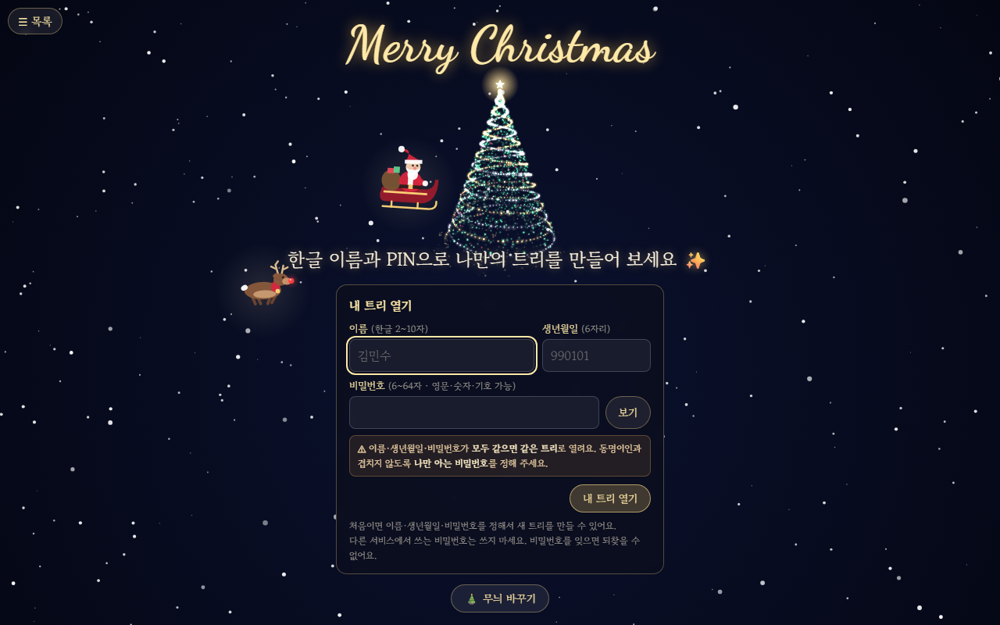
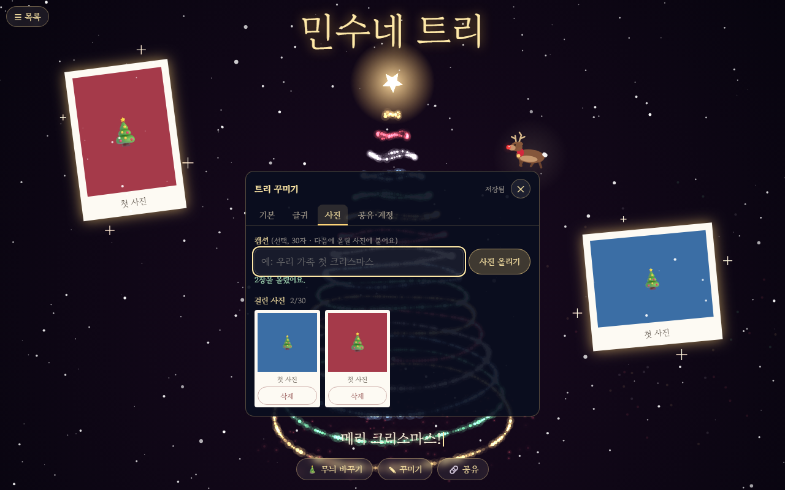
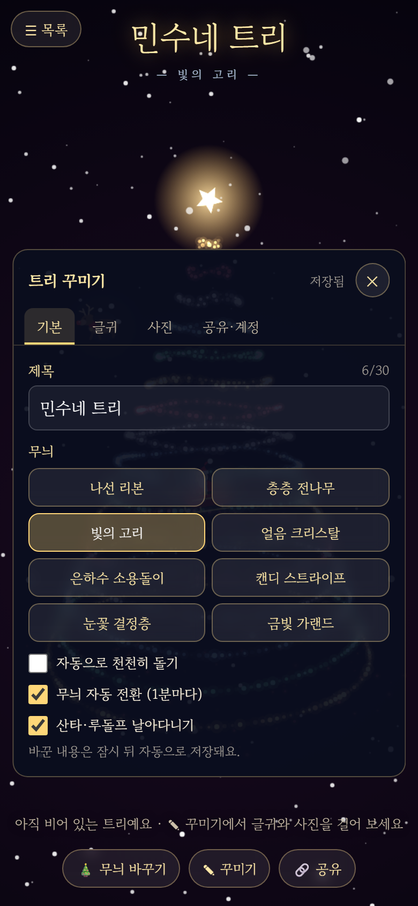
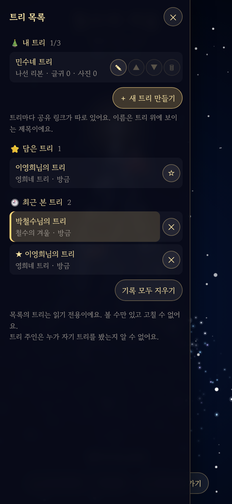

# 🎄 Code Christmas Tree

**이름 + 생년월일 + 비밀번호**로 나만의 파티클 3D 크리스마스 트리를 만들고(최대 3개), 글귀와 사진을 걸어 **링크 하나로** 보여 주는 웹앱입니다.

**👉 바로 써 보기: https://dae-won-kim.github.io/code-christmas-tree/**

<p>
  
  
</p>

이 문서는 두 부분으로 나뉩니다.

| | 읽을 사람 | 내용 |
|---|---|---|
| **[Part 1. 사용 가이드](#part-1-사용-가이드)** | 트리를 만들어 보고 싶은 분 | 만드는 법, 꾸미는 법, 트리 여러 개, 공유·담기, 자주 묻는 질문 |
| **[Part 2. 프로젝트 소개 (포트폴리오)](#part-2-프로젝트-소개-포트폴리오)** | 개발자 · 채용 담당자 | 기술 스택, 개발 환경, DB 설계, 보안, 테스트, 배포, 문제 해결 사례 |

---

# Part 1. 사용 가이드

## 1. 트리 만들기 (회원가입이 따로 없어요)



1. [사이트](https://dae-won-kim.github.io/code-christmas-tree/)에 들어가면 **「내 트리 열기」** 칸이 보입니다.
2. **이름**(한글 2~10자), **생년월일**(6자리, 예: 990101), **비밀번호**(6~64자, 영문·숫자·기호 가능)를 입력하고 **[내 트리 열기]** 를 누릅니다.
3. 처음 쓰는 조합이면 *"새 트리를 만들까요?"* 라고 묻습니다. **[새 트리 만들기]** 를 누르면 끝입니다.

- ⚠ **이름·생년월일·비밀번호가 모두 같으면 같은 트리로 열려요.** 동명이인과 겹치지 않도록 **나만 아는 비밀번호**를 정해 주세요.
  숫자로만 된 짧은 비밀번호로 만들려고 하면 한 번 더 알려 드려요.
- 다른 서비스에서 쓰는 비밀번호는 쓰지 마세요. **[보기]** 버튼으로 입력한 비밀번호를 확인할 수 있어요.
- 다음부터는 같은 이름·생년월일·비밀번호를 입력하면 내 트리가 열립니다.

## 2. 꾸미기

아래 **[✎ 꾸미기]** 를 누르면 편집 패널이 열립니다. 바꾼 내용은 잠시 뒤 **자동으로 저장**돼요.

<p>
  
  
</p>

| 탭 | 할 수 있는 일 |
|---|---|
| **기본** | 제목, 무늬 **8종** 고르기, 자동 회전 · 무늬 자동 전환(**1분마다**) · 산타·루돌프 켜고 끄기 |
| **글귀** | 한 줄 글귀 추가(Enter) · 삭제. 트리 아래에 타이핑 효과로 한 줄씩 나와요 |
| **사진** | 여러 장을 한 번에 올리기(캡션 선택), 삭제(두 번 눌러 확인). 사진은 트리 주변에서 떨어지거나 반짝 나타나요 |
| **공유·계정** | 공유 링크 복사, 비밀번호 바꾸기, 로그아웃 |

- 무늬: 나선 리본 · 층층 전나무 · 빛의 고리 · 얼음 크리스탈 · 은하수 소용돌이 · 캔디 스트라이프 · 눈꽃 결정층 · 금빛 가랜드
- 트리는 **드래그해서 돌려 볼 수** 있고, 떠 있는 **사진을 누르면 크게** 보입니다.
- 하늘을 날아다니는 **산타와 루돌프를 누르면** 말풍선과 함께 반응해요. 🎅🦌

## 3. 트리 여러 개 (최대 3개)


왼쪽 위 **[☰ 목록]** 을 펼치면 맨 위에 **🎄 내 트리**가 있어요.

- **＋ 새 트리 만들기**: 한 사람당 3개까지. 트리마다 제목·무늬·글귀·사진·**공유 링크가 따로** 있어요.
- **✎** 이름 바꾸기(트리 위에 보이는 제목과 같아요) · **▲▼** 순서 바꾸기 · **🗑** 지우기(두 번 눌러 확인)
- 사진이 있는 트리는 사진을 먼저 지워야 지울 수 있어요. 마지막 하나 남은 트리는 지울 수 없어요.
- 다음에 들어오면 **마지막으로 꾸민 트리**가 열려요.

## 4. 공유하기 · 다른 사람의 트리 담기

**[🔗 공유]** 를 누르면 지금 트리의 링크(`…/?t=xxxxxxxxxxxx`)가 복사됩니다. 받은 사람은:

- 로그인 없이 바로 트리를 봅니다. 제목 아래에 **"OOO님의 트리"** 가 보여요.
- **읽기 전용**이라 글귀·사진을 바꿀 수 없습니다. 무늬 바꾸기는 그 사람 화면에서만 바뀌고 저장되지 않아요.
- **[☆ 담기]** 로 내 목록에 저장해 두고, **[✨ 나도 트리 만들기]** 로 자기 트리를 만들 수 있습니다.

<p>
  
  
</p>

- **[☰ 목록]** 에는 **⭐ 담은 트리**와 **🕘 최근 본 트리**(공유 링크로 본 트리가 *"OOO님의 트리"* 로 자동 기록, 최근 50개)도 있어요. 평소에는 접혀 있어서 트리를 가리지 않아요.
- 목록에서 고르면 그 트리로 바로 넘어가고, 브라우저의 **뒤로 가기**로 돌아올 수 있어요.
- 로그인하지 않고 본 기록은 그 브라우저에만 남았다가, **로그인하면 내 목록으로 합쳐져** 다른 기기에서도 보입니다.
- 트리 주인은 **누가 자기 트리를 봤는지 알 수 없습니다.**

## 5. 사용자마다 화면이 다른가요?

**사이트 주소는 모두 같지만, 로그인한 뒤 보이는 트리는 사람마다 다릅니다.**

| 상황 | 보이는 화면 |
|---|---|
| 처음 접속 (로그인 전) | 모두 같은 **로그인 화면** |
| 로그인 후 | **내 트리** — 내가 정한 제목 · 무늬 · 설정 · 글귀 · 사진. 다른 사람의 트리와 완전히 분리돼 있어요 |
| 공유 링크(`?t=…`)로 접속 | 그 링크의 트리 (읽기 전용) |
| 왼쪽 위 [☰ 목록] | **내가** 만든 트리 · 담은 트리 · 최근 본 트리 — 사람마다 다른 목록 |

- 사람은 **이름 + 생년월일 + 비밀번호** 세 가지로 구분합니다. 이름이 같아도 생년월일이나 비밀번호가 다르면 다른 사람이에요.
- 한 번 들어가면 **그 브라우저에서는 30일 동안 로그인이 유지**됩니다. 다른 기기에서는 한 번 더 입력하면 같은 트리가 열려요.
- 휴대폰에서는 빛 입자와 눈송이 수를 줄여서 가볍게 보여 줍니다.

## 6. 한도와 주의할 점

| 항목 | 한도 |
|---|---|
| 트리 | 한 사람당 3개 |
| 제목 | 30자 |
| 글귀 | 한 줄 100자, 트리당 50개 |
| 사진 | 트리당 30장, 캡션 30자 (올릴 때 긴 변 1280px JPEG로 자동으로 줄여요) |
| 담은 트리 · 최근 본 트리 | 100개 · 최근 50개 |
| 로그인 시도 | 같은 이름·생년월일로 15분에 10번까지 |

- **공유 링크를 받은 사람은 이름 · 제목 · 글귀 · 사진을 볼 수 있습니다.** 보여 주고 싶지 않은 사진은 올리지 마세요.
- **비밀번호를 잊어버리면 되찾을 방법이 없습니다.** 비밀번호와 생년월일은 되돌릴 수 없는 형태(해시)로만 저장되어 관리자도 알 수 없어요.
- 틀린 비밀번호로 여러 번 시도하면 그 이름·생년월일은 **15분 동안 잠깁니다.**
- 비밀번호를 바꾸면 **지금 쓰는 기기를 뺀 다른 기기는 모두 로그아웃**됩니다.

---

# Part 2. 프로젝트 소개 (포트폴리오)

## 한눈에 보기

| | |
|---|---|
| **무엇을** | (이름, 생년월일, 비밀번호) 기반 개인 트리(최대 3개) 생성 · 편집 · 공유 웹앱 — 파티클 3D 렌더링, 배경 캐릭터, 담기 · 본 기록 목록 |
| **프론트엔드** | **바닐라 JavaScript (ES 모듈), 빌드 도구 없음** · Canvas 2D에 3D 원근 투영을 직접 구현 · 캐릭터도 그림 파일 없이 캔버스 도형으로 |
| **백엔드** | **서버 코드 없음.** Supabase(PostgreSQL + PostgREST + Storage) — 로직과 보안 검사는 전부 **PostgreSQL 함수(RPC 21개)** 안에 있음 |
| **DB 핵심** | `(이름, HMAC(생년월일), HMAC(비밀번호))` **복합 기본키** + 대리키 `id` · 사용자/트리 분리 · RLS ON + 정책 없음 → 테이블 직접 접근 불가, RPC로만 읽기/쓰기 |
| **배포** | GitHub Pages(GitHub Actions) + Supabase GitHub 통합(`main` push 시 마이그레이션 자동 적용) |
| **비용** | **0원** — GitHub Pages(Public) + Supabase Free |
| **테스트** | DB 보안·기능 테스트 **135개** (PostgreSQL 16 컨테이너, 업그레이드 시나리오 포함) · 화면 E2E **23개 시나리오 × 3개 화면 크기** (Playwright) · 모두 CI에서 자동 실행 |
| **보안** | 비밀번호·생년월일·세션 토큰 해시 저장, (이름, 생년월일)별 속도 제한, 티켓 방식 업로드, CSP + SRI, `textContent` 출력 |

## 기술 스택

| 영역 | 사용 기술 | 고른 이유 |
|---|---|---|
| 렌더링 | Canvas 2D, 직접 만든 원근 투영 · 가산 혼합 · 모핑 | WebGL 라이브러리 없이 2,600개 입자를 그리고 무늬 8종을 1:1로 모핑. 모바일은 1,500개로 자동 조절 |
| 프론트엔드 | Vanilla JS (ES Modules), HTML, CSS | 빌드 단계가 없어서 `web/` 폴더를 그대로 정적 호스팅. 의존성은 CDN의 supabase-js 하나 |
| 데이터 | Supabase PostgreSQL, PostgREST RPC, `pgcrypto` | 서버 없이 DB 함수(`security definer`)가 권한 검사를 직접 수행 |
| 파일 | Supabase Storage (public 버킷, 2MB, JPEG만) | 업로드 전 브라우저에서 리사이즈(긴 변 1280px), 티켓이 있는 경로만 업로드/삭제 허용 |
| 클라이언트 SDK | `@supabase/supabase-js` 2.118.0 (UMD, jsDelivr) | **버전 고정 + SRI(integrity)** 로 파일 내용까지 고정. 서버 모드에서만 로드 |
| 호스팅 · CI/CD | GitHub Pages, GitHub Actions 3개 워크플로 | 배포(`pages.yml`), DB 테스트(`db-test.yml`), E2E(`e2e.yml`) |
| 테스트 | PostgreSQL 16 (Docker) + SQL 테스트, Playwright 1.64 (Chromium) | DB는 실제 Postgres로, 화면은 `window.supabase` mock으로 검증 |

## 개발 환경

| 항목 | 내용 |
|---|---|
| OS · 에디터 | Windows 11, VS Code |
| 런타임 | Node.js 24 (E2E 도구 전용), Python 3.12 (로컬 개발 서버 `scripts/serve.py`) |
| DB 테스트 | Docker Desktop의 `postgres:16` 컨테이너 (Supabase의 `storage` 스키마 등은 mock으로 흉내) |
| 협업 도구 | Claude Code(AI 코딩 에이전트)와 함께 개발 — 작업 규칙은 [`CLAUDE.md`](CLAUDE.md), 단계별 계획은 [`docs/ROADMAP.md`](docs/ROADMAP.md) |
| CI | GitHub Actions (`ubuntu-latest`) — PostgreSQL 16 서비스 컨테이너, Playwright Chromium |

## 아키텍처

```
┌──────────── GitHub Pages (정적 파일만) ─────────────┐
│ index.html · css · js (ES 모듈)                      │
│  ├─ tree/   캔버스 렌더러 createTree(canvas)          │
│  │          무늬 8종 · 사진 · 산타·루돌프 · 눈         │
│  ├─ ui/     로그인 · 내 트리(편집) · 공유 보기 · 목록  │
│  └─ api.js  TreeApi ← 모든 DB 접근의 유일한 통로     │
└───────────────┬──────────────────────────────────────┘
                │ HTTPS · Publishable key (공개돼도 되는 키)
┌───────────────▼───────── Supabase (Free) ────────────┐
│ PostgREST → public 스키마 RPC 21개 (security definer) │
│               └ tree_users · trees · messages ·       │
│                 photos · tree_views                   │
│                 RLS ON + 정책 없음 + 테이블 권한 회수  │
│             → private 스키마 (API 비노출)              │
│               secrets(pepper) · sessions ·             │
│               auth_attempts · upload_tickets           │
│ Storage   → tree-photos 버킷 (티켓 있는 경로만 쓰기)   │
└────────────────────────────────────────────────────────┘
```

- 화면 모드는 주소와 저장된 토큰으로 정합니다: `config` 없음 → **데모**, `?t=` → **공유 보기**, 토큰 있음 → **내 트리**, 그 밖 → **로그인**.
- 트리 렌더러는 DB를 모릅니다. 화면 모듈이 `TreeApi`로 받은 데이터를 `tree.setTitle / setPattern / setSettings / setMessages / addPhoto / removePhoto`로 넘깁니다.

## DB 설계

### 테이블

| 테이블 | 스키마 | 핵심 컬럼 · 제약 |
|---|---|---|
| `tree_users` | public | **PK `(name, birth_hash, pw_hash)`** · `id uuid unique`(대리키) · 이름 `^[가-힣]{2,10}$` |
| `trees` | public | `owner_id → tree_users.id` · `share_id`(공유용 랜덤 12자) · `title` 1~30자 · `pattern` 0~7 · `settings jsonb` ≤2KB · `position`(목록 순서) · 사용자당 3개 |
| `messages` | public | `tree_id → trees.id` (cascade) · `body` 1~100자 · 트리당 50개 |
| `photos` | public | `tree_id → trees.id` (cascade) · `path` = `<tree_id>/<uuid>.jpg` · `caption` ≤30자 · 트리당 30장 |
| `tree_views` | public | **PK `(viewer_id, tree_id)`** · `saved`(담기, 100개) · `viewed_at`(본 기록, 최근 50개) · 자기 트리 제외 |
| `secrets` | private | `pin_pepper` — init 마이그레이션 때 DB 안에서 랜덤 32바이트 생성 (저장소에 없음) |
| `sessions` | private | `sha256(token)` → user_id, 30일 만료 |
| `auth_attempts` | private | (이름, 생년월일 해시) 단위 로그인 · 생성 · 비밀번호 변경 시도 기록 (속도 제한용) |
| `upload_tickets` | private | (경로, upload/delete) → user_id, tree_id, 10분 만료 |

### 설계 결정

1. **복합 기본키 `(이름, 생년월일, 비밀번호)` — bcrypt가 아니라 HMAC-SHA256(pepper)**
   첫 배포는 (이름, PIN)이었는데, 동명이인이 같은 PIN을 고르면 같은 사람으로 합쳐지는 문제가 있어 생년월일을 키에 넣고 PIN을 문자 비밀번호로 바꿨습니다.
   bcrypt는 같은 입력이라도 매번 해시가 달라 기본키로 조회할 수 없어서, 같은 입력이면 같은 값인 HMAC을 씁니다.
   `birth_hash = HMAC('birth:'‖이름‖생년월일)`, `pw_hash = HMAC(이름‖birth_hash‖비밀번호)` — **생년월일도 평문으로 저장하지 않습니다.**
2. **사용자와 트리를 분리하고, 다른 테이블은 대리키 `id`로 참조**
   비밀번호를 바꾸면 기본키가 바뀝니다. 복합키를 외래키로 쓰면 모든 행을 같이 고쳐야 하지만, `id` 참조라서 영향이 없습니다(테스트 T14).
   트리를 분리해 사용자당 3개를 허용하고, 동시에 만들어도 제한이 깨지지 않게 사용자 행을 잠급니다(`for update`).
3. **브라우저는 테이블에 접근할 수 없고 RPC만 호출**
   RLS를 켜고 정책을 만들지 않았으며, 테이블 권한도 회수했습니다(이중 안전장치). 모든 RPC는 `security definer` + `set search_path = ''`이고,
   토큰으로 사용자를 확인한 뒤 `owned_tree(사용자, 트리 id)`로 내 트리인지 검사합니다.
4. **실패 기록을 남기는 경로는 `raise` 대신 `{ok:false}` 반환**
   PostgreSQL은 예외가 나면 트랜잭션 전체를 롤백합니다. 로그인 실패 때 `raise`하면 방금 저장한 "실패 시도 기록"까지 사라져 무차별 대입 방지가 무력화되기 때문에, 로그인과 비밀번호 확인은 값을 반환합니다.
5. **사진 업로드 · 삭제는 "티켓" 방식**
   Storage 정책은 우리 세션 토큰을 볼 수 없습니다. 그래서 RPC가 "이 경로에 10분간 업로드해도 됨"이라는 티켓을 발급하고, Storage 정책은 티켓이 있는지만 확인합니다. 확정 단계에서 파일이 실제로 있는지(업로드) · 사라졌는지(삭제)를 DB가 다시 검사해서 파일과 기록이 어긋나지 않게 합니다.
6. **담기 · 본 기록은 "권한"이 아니라 "목록"**
   `tree_views`는 share_id를 가리키는 목록일 뿐이라, 담아도 쓰기 권한이 생기지 않습니다(T23). 트리 주인이 "누가 봤는지" 조회하는 RPC는 없습니다.
7. **배포 후 스키마 변경은 새 마이그레이션 + 업그레이드 테스트**
   v2 마이그레이션은 v1 구조를 감지했을 때만 옛 데이터를 정리하고(운영자 결정), 다시 실행하면 아무것도 지우지 않습니다.
   "배포된 v1 DB → v2 적용 → 다시 적용" 시나리오를 별도 DB에서 자동 검증합니다(`supabase/tests/upgrade/`).

### RPC 21개

`enter_tree` · `change_password` · `logout` · `get_my_tree` · `get_tree` · `update_tree` · `list_my_trees` · `create_tree` · `delete_tree` · `reorder_trees` · `add_message` · `delete_message` · `begin_photo_upload` · `finish_photo_upload` · `begin_photo_delete` · `finish_photo_delete`
· (목록) `record_view` · `list_trees` · `set_saved` · `forget_views` · `merge_views`
— 인자 · 반환 · 오류 코드 명세는 [`docs/DATABASE.md`](docs/DATABASE.md)

## 보안

| 위협 | 대응 | 검증 |
|---|---|---|
| 공개 키로 테이블 직접 조회 · 수정 | RLS ON + 정책 없음 + 권한 회수 | DB 테스트 T8 · T26 · T39, 배포 후 실제 조회 → `42501` 권한 오류 확인 |
| pepper · 세션 테이블 노출 | `private` 스키마 (API 비노출) | 배포 후 `PGRST106 Invalid schema: private` 확인 |
| 동명이인이 같은 비밀번호로 남의 트리에 들어감 | 생년월일을 키에 추가 + 로그인 화면 안내 | T7 |
| 비밀번호 무차별 대입 | (이름, 생년월일)당 15분 10회, 실패도 기록(롤백 방지) | T15 |
| 남의 트리 · 글귀 · 사진 수정 · 삭제 | 모든 RPC가 토큰의 user_id로 범위 제한, 트리 id는 소유 확인 | T11, T13, T35 |
| 남의 경로에 업로드 · 삭제 | 티켓이 있는 경로만 허용 | T12, T13 |
| DB 유출 시 비밀번호 · 생년월일 · 토큰 노출 | HMAC · SHA-256 해시만 저장 | T19 |
| 남의 목록 엿보기, 담기로 남의 트리 수정 | `tree_views`도 RPC로만 접근, 토큰 주인의 목록만 조회 · 쓰기 권한 없음 | T21, T23, T26 |
| XSS로 토큰 탈취 (토큰이 localStorage에 있음) | ① 사용자 입력은 `textContent`로만 출력 ② **CSP**로 스크립트 출처를 `self` + jsDelivr로 제한 ③ supabase-js **SRI** | E2E(XSS 문자열이 글자 그대로 출력), CSP 위반 0 |
| 관리자 키가 웹에 들어감 | 배포 워크플로와 앱 양쪽에서 `sb_secret_` 키를 감지하면 중단 | — |

**알고 있는 한계:** 조회를 위해 빠른 HMAC을 쓰므로, DB 전체와 pepper가 함께 유출되면 짧은 비밀번호는 오프라인 대입으로 풀릴 수 있습니다(생년월일은 경우의 수가 적어 보호 효과가 작음). 그래서 길고 나만 아는 비밀번호를 권하는 문구를 화면에 둡니다. 이름 · 생년월일 · 비밀번호가 모두 같은 두 사람은 구분할 수 없고, 특정 (이름, 생년월일)로 10번 틀리면 진짜 주인도 15분간 잠기는 문제(잠금 DoS)는 의도적으로 감수했습니다. 자세한 내용은 [`docs/ARCHITECTURE.md`](docs/ARCHITECTURE.md)를 보세요.

## 프론트엔드 설계

```
web/js/
├── main.js          진입점 · 모드 결정 · 화면 전환 (새로고침 없이 destroy → mount, pushState/popstate)
├── api.js           TreeApi — RPC 래퍼, 오류 코드 → 한국어 메시지(TreeError)
├── image.js         업로드 전 리사이즈 (품질을 단계적으로 낮춰 2MB 이하 보장)
├── tree/            renderer(루프·투영·별·눈) · patterns(무늬 8종) · photos(연출·히트 테스트)
│                    · viewer(FLIP 확대) · messages(타이핑) · characters(산타·루돌프)
└── ui/              dom(공통) · login · editor · share · library(사이드 목록)
```

- **트리 API:** `createTree(canvas, options)` → `{ setPattern, nextPattern, setMessages, setTitle, setSettings, addPhoto, removePhoto, clearPhotos, layout, destroy }`
- **배경 캐릭터:** 산타(썰매)와 루돌프를 캔버스 경로로 직접 그리고, 화면 안의 목표 지점을 바꿔 가며 부드럽게 방향을 틀어 납니다. 클릭 판정은 사진 → 캐릭터 → 빈 곳(반짝이) 순서. `prefers-reduced-motion`이면 느리게.
- **저장:** 제목 · 무늬 · 설정은 800ms debounce 후 `update_tree` 한 번으로 묶어서 보내고, 패널을 닫거나 로그아웃할 때 남은 변경을 바로 보냅니다.
- **사이드 목록:** 내 트리(이름 · 순서 · 만들기 · 지우기) · 담은 트리 · 최근 본 트리. 기본 접힘, 펼침 상태 기억, 접히면 `inert`. 좁은 화면에서는 꾸미기 패널과 서로 겹치지 않게 하나를 열면 다른 하나가 닫힙니다.
- **한글 IME:** `compositionstart~end` 동안에는 검증 메시지를 바꾸지 않고, 조합을 확정하는 Enter로는 제출하지 않습니다(트리 이름 바꾸기 입력칸도 동일).
- **접근성:** 버튼 `aria-label`, WAI-ARIA 탭 패턴(방향키 · Home · End), 패널을 열면 첫 입력칸으로 포커스 이동, Esc로 닫기, 타이핑 글귀는 화면 낭독기용 목록으로 따로 제공.
- **반응형:** 데스크톱(1280×800) · 모바일(390×844) · 가로 모바일(844×390), safe-area, iOS 확대를 막기 위해 입력창 16px 이상.

## 테스트와 품질

| 종류 | 도구 | 내용 |
|---|---|---|
| DB 보안 · 기능 | PostgreSQL 16 + SQL (`supabase/tests/`) | **135개** — 이름 · 생년월일 · 비밀번호 형식, 동명이인 구분(복합키), 트리 3개 제한 · 소유 확인 · 순서 · 삭제 규칙, 담기 · 본 기록, 테이블 직접 접근 차단, 티켓 위조 · 재사용, 속도 제한 롤백 방지, 비밀번호 변경 시 다른 세션 해제, 해시 저장 등. 마이그레이션 **파일마다 2번 연속 적용**(재실행 안전성) |
| 업그레이드 | 별도 DB | 배포된 v1 DB(데이터 있음) → v2 적용 → 다시 적용 시나리오 (v1 정리, v2 데이터 보존) |
| 화면 E2E | Playwright + `window.supabase` mock | **23개 시나리오 × 데스크톱 · 모바일 · 가로** — 전체 흐름(로그인 → 생성 → 꾸미기 → 글귀 → 사진 → 공유 → 비밀번호 변경 → 재로그인 → 시크릿 창 공유 보기), 내 트리 3개(만들기 · 이름 · 순서 · 전환 · 지우기), 산타 · 루돌프 반응, 무늬 8종, 사이드 목록, XSS, 세션 만료, 네트워크 오류 · 느린 네트워크, IME, 클립보드 실패, 키보드 탐색. 모든 테스트에서 **Console 오류 0**을 자동 확인 |
| 리팩터링 회귀 | 픽셀 비교 | 단일 파일 프로토타입을 모듈로 나누기 전후를 `Math.random` 시드 고정 + 가짜 시계로 같은 시점에 찍어 **12장 모두 픽셀 차이 0%** 확인 |
| 실제 환경 | Playwright → 배포 사이트 + 실제 Supabase | 배포 체크리스트(업로드 · 삭제 정책 실동작, 직접 조회 차단, 공유 읽기 전용) 통과 |

## 배포 파이프라인

```
git push main ─┬─▶ GitHub Actions: pages.yml   → Variables로 config.js 생성 → web/ 배포 (GitHub Pages)
               ├─▶ GitHub Actions: db-test.yml → PostgreSQL 16에서 마이그레이션 + 135개 테스트 + 업그레이드 시나리오
               ├─▶ GitHub Actions: e2e.yml     → Playwright E2E
               └─▶ Supabase GitHub 통합        → supabase/migrations 새 파일을 운영 DB에 적용
```

- 브라우저에 들어가는 값은 **Project URL과 Publishable key뿐**이고, 저장소 **Variables**로 관리합니다(`config.js`는 커밋하지 않음).
- 배포 뒤에는 기존 마이그레이션 파일을 고치지 않고, 새 파일을 추가하는 방식으로 스키마를 바꿉니다.

## 문제 해결 사례

| 문제 | 원인 | 해결 |
|---|---|---|
| 리팩터링 후 모양이 그대로인지 증명하기 어려움 | 입자 위치가 랜덤이고 애니메이션이 시간에 따라 바뀜 | `Math.random`을 시드 고정하고 Playwright 가짜 시계로 시간을 멈춘 뒤, 같은 시점 프레임을 픽셀 단위로 비교 → 0% 차이로 검증 |
| 동명이인이 같은 PIN을 쓰면 남의 트리가 열림 | (이름, PIN)만으로는 사람을 구분할 수 없음 | 생년월일을 복합 기본키에 추가하고 PIN을 문자 비밀번호로. 생년월일도 해시로 저장, 화면에 겹침 안내 |
| 이미 배포된 DB의 구조를 바꿔야 함 | 운영 중인 테이블 · 함수 시그니처가 바뀜 | v1을 감지할 때만 정리하는 가드 + 파일별 재실행 테스트 + "배포된 DB에 적용" 업그레이드 테스트 |
| Windows에서 로컬 서버로 열면 화면이 빔 | Python `http.server`가 레지스트리 설정 때문에 `.js`를 `text/plain`으로 보내 ES 모듈 로드가 거부됨 | MIME을 고정한 개발 서버 `scripts/serve.py` 작성. `config.js`가 없으면 빈 설정을 돌려줘 데모 모드로 열림 |
| Windows에서 고친 셸 스크립트가 CI·컨테이너에서 실패 | 편집 도구가 줄바꿈을 CRLF로 저장 → bash가 `set -o pipefail\r`을 못 읽음 | `.gitattributes`로 저장소 줄바꿈을 LF로 고정 |
| 새 DB 테스트가 "방금 쓴 내용이 안 보인다"며 실패 | 쓰기 RPC와 `stable` 함수를 한 SQL 문장에서 부르면, stable 함수는 문장 시작 시점 스냅샷을 봄 (함수 자체는 정상) | 쓰기와 확인을 두 문장으로 나누고, 새 RPC 체크리스트에 주의 사항으로 기록 |
| 실제 배포에서만 [꾸미기] 버튼이 가끔 반응 없음 | 로딩 중에도 버튼이 보였지만 편집 화면은 데이터를 받은 뒤에 연결됨. mock은 응답이 즉시 와서 드러나지 않았음 | 데이터를 받은 뒤 도구 막대를 표시하도록 수정하고, mock에 응답 지연 옵션을 넣어 회귀 테스트 추가 |
| 가로 모바일에서 꾸미기 탭이 안 눌림 | 펼친 사이드 목록이 꾸미기 패널 왼쪽을 덮음 | 1100px 미만에서는 둘 중 하나를 열면 다른 하나가 닫히도록 |

## 다음 단계

- 트리(계정) 삭제 · 사진 일괄 삭제 (Storage 파일까지)
- 담은 트리가 바뀌면 알림(새 글귀 · 사진 표시)
- 방문자 방명록(승인제), 공유 링크 OG 미리보기 이미지, 다국어

---

## 직접 실행하기 · 포크해서 운영하기

```bash
# 데모(서버 없이) 보기
python scripts/serve.py                 # → http://127.0.0.1:8000  (macOS/Linux는 python3)

# DB 테스트 (Docker 필요)
./scripts/test-db.sh

# 화면 E2E 테스트 (Node.js 필요)
npm ci && npx playwright install chromium
npm run test:e2e
```

내 Supabase 프로젝트로 운영하는 방법은 [`docs/DEPLOY.md`](docs/DEPLOY.md)에 있습니다. Fork → Supabase 프로젝트 생성 → 마이그레이션 적용 → GitHub Variables 2개 등록이면 됩니다.

| 문서 | 내용 |
|---|---|
| [`docs/ARCHITECTURE.md`](docs/ARCHITECTURE.md) | 구조, 인증 · 업로드 흐름, 위협 모델 |
| [`docs/DATABASE.md`](docs/DATABASE.md) | 테이블 · RPC 명세, 오류 코드, 새 RPC 체크리스트 |
| [`docs/DEPLOY.md`](docs/DEPLOY.md) | 배포 절차, 배포 후 체크리스트, 문제 해결 |
| [`docs/ROADMAP.md`](docs/ROADMAP.md) | 단계별 진행 상황 |

**보안 문제를 발견하면** 공개 이슈 대신 저장소 관리자에게 비공개로 알려 주세요.
이슈와 PR을 환영합니다. DB를 바꾸는 PR은 `./scripts/test-db.sh`, 화면을 바꾸는 PR은 `npm run test:e2e` 통과가 필요합니다(CI에서 자동 실행).

## 라이선스

[MIT](LICENSE)
