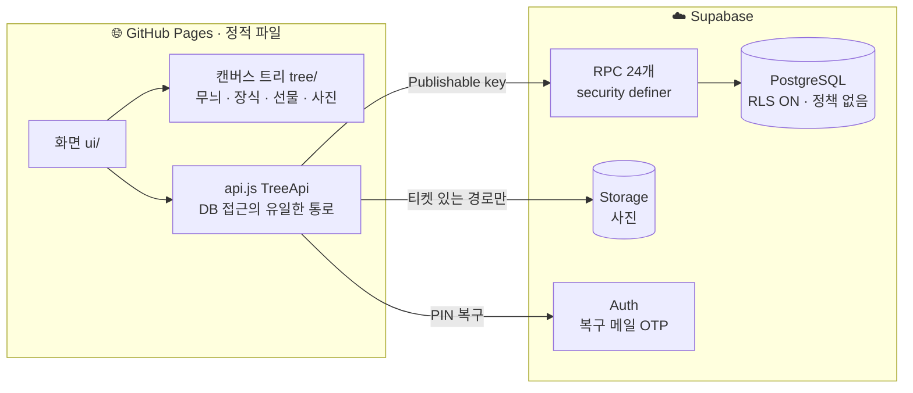
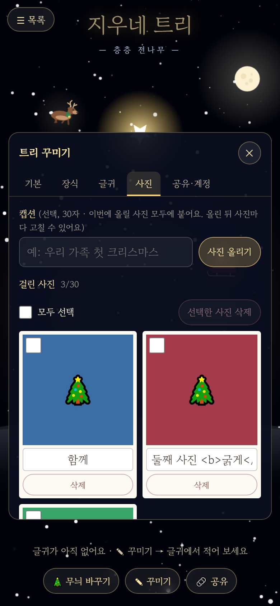
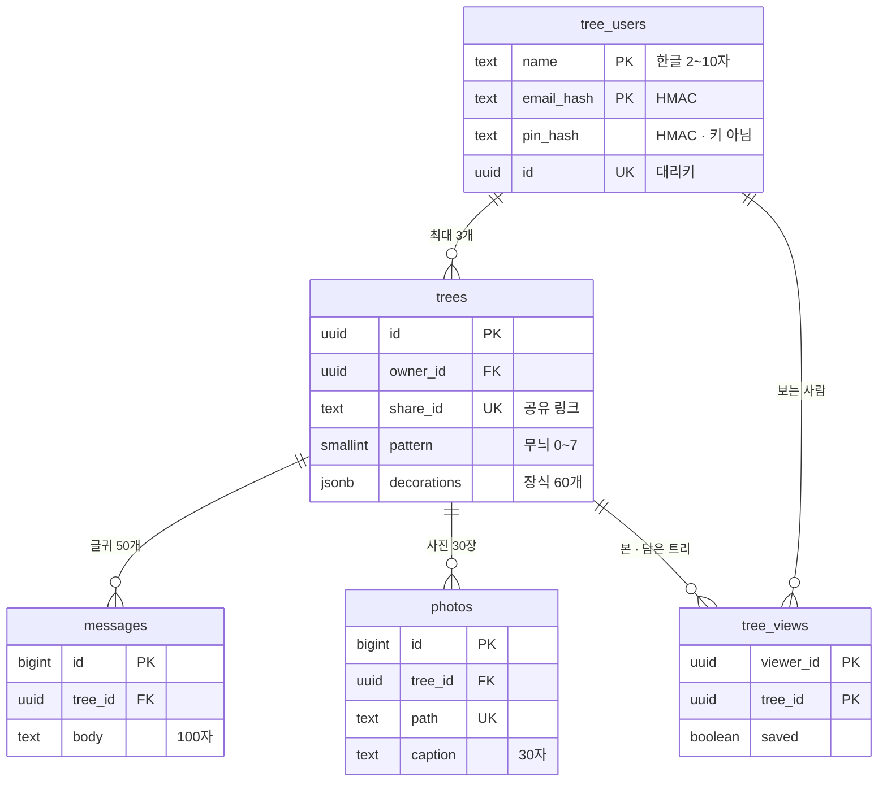
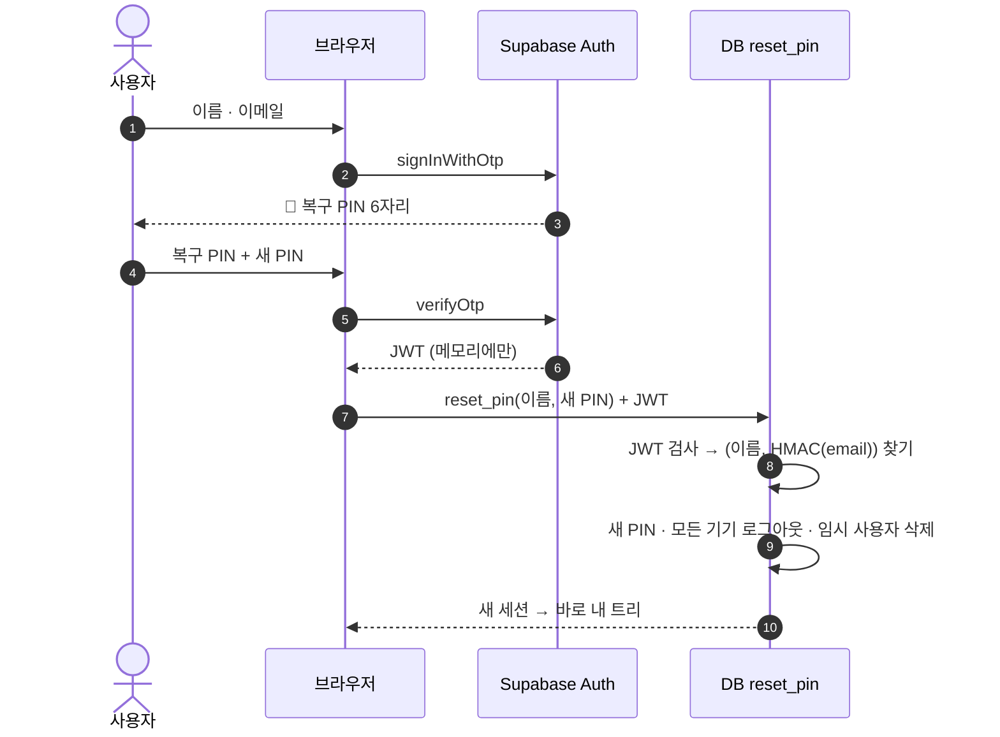
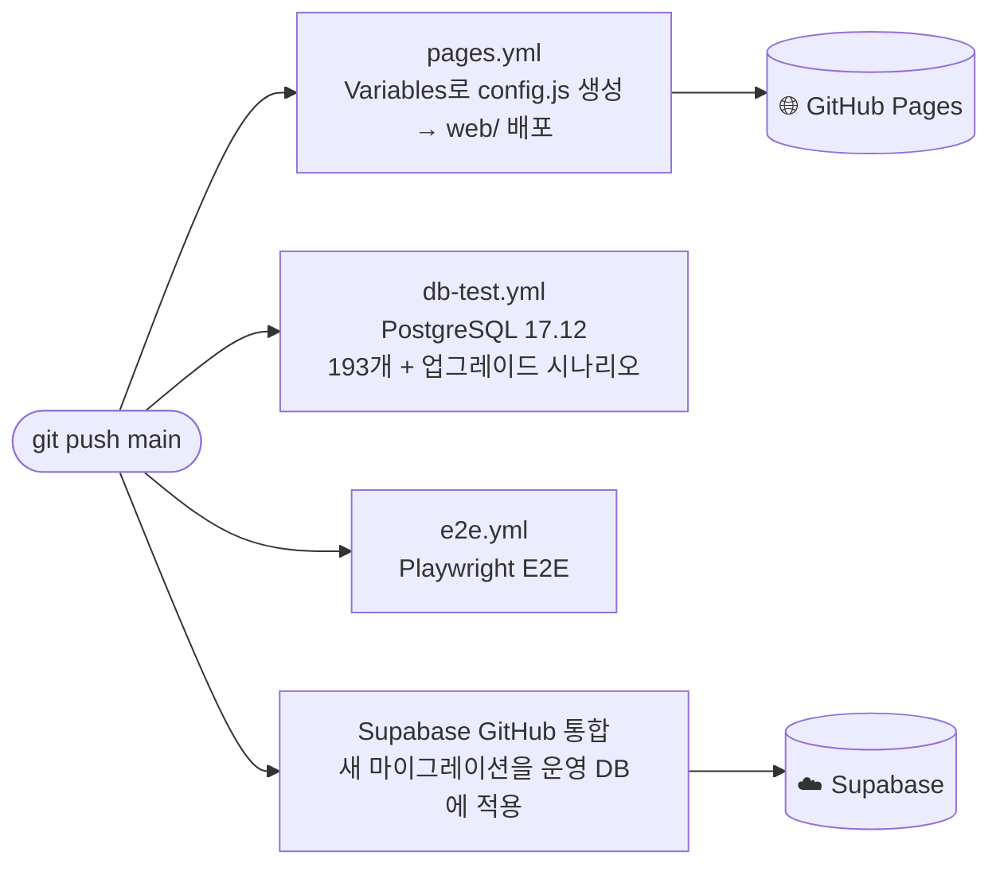

# 🎄 Code Christmas Tree

**이름 · 이메일 · PIN만으로 나만의 파티클 3D 크리스마스 트리를 만들고, 장식 · 글귀 · 사진을 걸어 링크 하나로 공유하는 웹앱**

**👉 바로 써 보기: https://dae-won-kim.github.io/code-christmas-tree/** · 라이선스: [MIT](LICENSE) · 운영 비용: **0원**

<p>
  
  
</p>

## 📌 핵심 요약

| | |
|---|---|
| **무엇** | 개인 트리(최대 3개)를 만들고 꾸며서 공유 링크로 보여 주는 웹앱. 받은 사람은 로그인 없이 읽기 전용으로 봄 |
| **핵심 기능** | 파티클 3D 트리 · 무늬 8종 모핑 · **장식 8종을 눌러 달고 끌어 옮기기** · 선물 상자 · 글귀 타이핑 · 사진(캡션 · 여러 장 삭제) · 담기 · 본 기록 · 이메일 PIN 복구 |
| **구조** | **서버 코드 없음** — 정적 호스팅(GitHub Pages) + Supabase(PostgreSQL). 로직과 보안 검사는 전부 **DB 함수(RPC 24개)** 안에 |
| **보안** | 테이블 직접 접근 차단(RLS + 권한 회수) · 이메일 · PIN · 토큰은 해시로만 저장 · 속도 제한 · 티켓 방식 업로드 · CSP + SRI |
| **품질** | DB 테스트 **193개**(PostgreSQL 17.12) · 화면 E2E **29개 시나리오 × 3개 화면**(Playwright) · 모두 CI 자동 실행 |

## 🧰 기술 스택

| 영역 | 기술 |
|---|---|
| 프론트엔드 | **Vanilla JavaScript (ES Modules)** · HTML · CSS — 빌드 도구 없음, 앱 npm 의존성 없음 |
| 렌더링 | **Canvas 2D** + 직접 구현한 3D 원근 투영 · 가산 혼합 · 모핑 (그림 파일 없이 도형으로 그림) |
| 백엔드 · DB | **Supabase** — PostgreSQL 17 · PostgREST RPC · Storage · Auth(이메일 OTP) · `pgcrypto` |
| 클라이언트 SDK | `@supabase/supabase-js` 2.118.0 (CDN, 버전 고정 + SRI) |
| 호스팅 · CI/CD | GitHub Pages · GitHub Actions(배포 · DB 테스트 · E2E) · Supabase GitHub 통합(마이그레이션 자동 적용) |
| 테스트 | PostgreSQL 17.12 컨테이너 + SQL 테스트 · Playwright 1.64 (Chromium, `window.supabase` mock) |

## 🏗️ 구현 방법



1. **RPC만 쓰는 DB 접근** — 브라우저는 테이블에 직접 닿지 못하고(RLS ON + 정책 없음 + 권한 회수), `security definer` 함수만 호출합니다. 함수가 토큰으로 사용자를 찾고 `owned_tree`로 내 트리인지 매번 확인합니다.
2. **(이름, 이메일) 복합 기본키 + PIN 해시** — 이메일과 PIN은 HMAC-SHA256(pepper)으로만 저장합니다. PIN은 키에 넣지 않아 틀려도 트리가 하나 더 생기지 않습니다.
3. **서버 없는 PIN 복구** — Supabase Auth 이메일 OTP로 메일 주인을 확인하고, DB 함수가 JWT의 `email` · `amr` · 시각을 검사한 뒤 PIN을 바꿉니다.
4. **티켓 방식 사진 업로드** — RPC가 "이 경로에 10분간 올려도 됨" 티켓을 주고, Storage 정책은 티켓만 확인합니다. 확정 단계에서 파일이 실제로 있는지 DB가 다시 확인합니다.
5. **원뿔 표면 좌표 장식** — 장식 위치를 (높이, 둘레 각도)로 저장해서 트리를 돌려도 장식이 함께 돕니다. 뒤쪽 장식은 입자 뒤에 흐리게 그려 깊이감을 냅니다.

자세한 구조와 흐름 그림: [`docs/ARCHITECTURE.md`](docs/ARCHITECTURE.md) · DB 관계도와 RPC 명세: [`docs/DATABASE.md`](docs/DATABASE.md)

## 📄 라이선스

- 이 저장소의 코드 · 문서 · 그림은 **dae-won-kim**이 만들었고 **[MIT 라이선스](LICENSE)** 로 배포합니다.
- 실행 중에 불러오는 외부 리소스(supabase-js — MIT, Gowun Batang · Dancing Script 글꼴 — SIL OFL 1.1)와 개발용 도구(Playwright — Apache 2.0, PostgreSQL)는
  각 저작권자의 라이선스를 따릅니다. 저장소에 포함하지 않으며, 목록은 **[THIRD_PARTY_NOTICES.md](THIRD_PARTY_NOTICES.md)** 에 있습니다.
- 캐릭터(산타 · 사슴) · 장식 · 선물 상자 · 트리 무늬는 그림 파일 없이 캔버스 도형으로 직접 그렸고, 특정 캐릭터(상표)를 흉내 내지 않습니다.

## 🚀 빠른 시작

```bash
python scripts/serve.py            # 데모(서버 없이) → http://127.0.0.1:8000  (macOS/Linux는 python3)
./scripts/test-db.sh               # DB 테스트 (Docker 필요)
npm ci && npx playwright install chromium && npm run test:e2e   # 화면 E2E
```

내 Supabase로 운영하기: Fork → Supabase 프로젝트 → 마이그레이션 적용 → 복구 메일(SMTP · 템플릿) → GitHub Variables 2개 — [`docs/DEPLOY.md`](docs/DEPLOY.md)

---

# 자세히 보기

## 주요 기능

| 기능 | 설명 |
|---|---|
| **가입 없는 시작** | 이름 · PIN · 이메일을 정하면 바로 트리가 생깁니다. 다음부터는 같은 값으로 열기 |
| **꾸미기** | 제목 · 무늬 8종 · 자동 회전 · 무늬 자동 전환(1분) · 글귀(50개) · 사진(30장, 자동 리사이즈) |
| **장식** | 방울 · 전구 · 별 · 양말 · 종 · 사탕 · 리본 · 눈꽃 × 6색. **트리를 눌러 달고, 끌어서 옮기고, 트리 밖으로 끌어내 떼기** (트리당 60개, 키보드로는 [아무 곳에 달기]) |
| **선물 상자 · 밤하늘** | 트리 아래 선물 상자(누르면 뚜껑이 열리며 반짝임), 별 · 달 · 눈 언덕, 배경을 나는 산타와 사슴(누르면 반응) |
| **사진** | 여러 장을 한 번에 올리고, 사진마다 캡션을 바로 고치고, 여러 장을 골라 한 번에 삭제 |
| **트리 3개** | 사이드 목록에서 새로 만들기 · 이름 바꾸기 · 순서(▲▼) · 지우기. 트리마다 공유 링크가 따로 |
| **공유** | 링크(`?t=...`)를 받은 사람은 로그인 없이 **읽기 전용**으로 봄. 마음에 들면 [담기]로 내 목록에 |
| **본 기록 · 담은 트리** | 접히는 사이드 목록에 "누구의 트리"로 정리. 로그인 전 기록은 브라우저에, 로그인하면 DB로 합침 |
| **PIN 변경 · 복구** | 꾸미기 → 공유·계정에서 PIN 변경, 잊었으면 로그인 화면의 [PIN을 잊었어요] → 메일로 복구 |

<p>
  
  
</p>

- 사이트는 하나지만 **보이는 트리는 사람마다 다릅니다.** 로그인하면 내 트리, 공유 링크로 들어오면 그 사람의 트리, 아무것도 없으면 로그인 화면이 나옵니다.
- 같은 이름이라도 이메일이 다르면 다른 사람입니다. PIN을 틀리면 새 트리를 만들지 않고 "PIN이 맞지 않아요"라고 알려 줍니다.

## 기술 선택 이유

| 영역 | 사용 기술 | 고른 이유 |
|---|---|---|
| 렌더링 | Canvas 2D, 직접 만든 원근 투영 · 가산 혼합 · 모핑 | WebGL 라이브러리 없이 2,600개 입자를 그리고 무늬 8종을 1:1로 모핑. 모바일은 1,500개로 자동 조절 |
| 프론트엔드 | Vanilla JS (ES Modules), HTML, CSS | 빌드 단계가 없어 `web/` 폴더를 그대로 정적 호스팅. 의존성은 CDN의 supabase-js 하나 |
| 데이터 | Supabase PostgreSQL, PostgREST RPC, `pgcrypto` | 서버 없이 DB 함수(`security definer`)가 권한 검사를 직접 수행 |
| 파일 | Supabase Storage (public 버킷, 2MB, JPEG만) | 업로드 전 브라우저에서 리사이즈(긴 변 1280px), 티켓이 있는 경로만 업로드/삭제 허용 |
| 메일 | Supabase Auth 이메일 OTP + Custom SMTP | 메일 API 키나 Edge Function 없이 복구 메일 발송 · 메일 주인 확인 |
| 클라이언트 SDK | `@supabase/supabase-js` 2.118.0 (UMD, jsDelivr) | **버전 고정 + SRI(integrity)** 로 파일 내용까지 고정. 서버 모드에서만 로드 |
| 호스팅 · CI/CD | GitHub Pages, GitHub Actions 3개 워크플로 | 배포(`pages.yml`), DB 테스트(`db-test.yml`), E2E(`e2e.yml`) |
| 테스트 | PostgreSQL 17.12 (Docker) + SQL 테스트, Playwright 1.64 (Chromium) | DB는 운영과 같은 버전의 실제 Postgres로, 화면은 `window.supabase` mock으로 검증 |

## DB 설계



`private` 스키마(API 비노출)에는 `secrets`(pepper) · `sessions`(sha256 토큰) · `auth_attempts`(속도 제한) · `upload_tickets`(10분 티켓)가 있습니다. 전체 관계도와 컬럼 제약은 [`docs/DATABASE.md`](docs/DATABASE.md)를 보세요.

### 설계 결정

1. **사람은 `(이름, 이메일)`로 찾고, PIN은 기본키에 넣지 않는다**
   첫 배포는 (이름, PIN) 복합키였는데, 동명이인이 같은 PIN을 고르면 같은 사람으로 합쳐지고 PIN을 잊으면 되찾을 수 없었습니다.
   이메일은 사람마다 다르고 복구 주소로도 쓸 수 있어 키로 바꿨습니다. PIN이 키에 있으면 PIN을 틀렸을 때 "없는 사람"이 되어
   같은 사람의 트리가 하나 더 생기므로, PIN은 확인용 값으로만 두고 틀리면 `wrong_pin`을 돌려줍니다.
2. **해시는 bcrypt가 아니라 HMAC-SHA256(pepper)**
   bcrypt는 같은 입력이라도 매번 해시가 달라 기본키로 조회할 수 없습니다. `email_hash = HMAC('email:'‖이메일)`로 조회하고,
   `pin_hash = HMAC('pin:'‖사용자 id‖PIN)`처럼 사용자 id를 섞어 같은 PIN도 사람마다 다른 값이 되게 했습니다. **이메일도 평문으로 저장하지 않습니다.**
3. **PIN 복구는 Supabase Auth 이메일 OTP + DB의 JWT 검사**
   DB 함수는 JWT의 `role`, `email`, `amr`(메일 코드 · 링크로 15분 안에 로그인했는지)을 검사하고, 끝나면 `auth.users`의 임시 사용자를 지워 평문 이메일을 남기지 않습니다.
   가입 때 메일 인증을 받지 않아도, 남이 내 이메일로 먼저 트리를 만들면 메일 주인이 복구로 되찾을 수 있습니다.
4. **사용자와 트리를 분리하고, 다른 테이블은 대리키 `id`로 참조**
   해시가 모든 행에 복사되지 않고, PIN을 바꿔도 다른 테이블은 영향을 받지 않습니다. 트리 3개 제한은 동시에 만들어도 깨지지 않게 사용자 행을 잠급니다(`for update`).
5. **브라우저는 테이블에 접근할 수 없고 RPC만 호출**
   RLS를 켜고 정책을 만들지 않았으며, 테이블 권한도 회수했습니다(이중 안전장치). 모든 RPC는 `security definer` + `set search_path = ''`입니다.
6. **실패 기록을 남기는 경로는 `raise` 대신 `{ok:false}` 반환**
   PostgreSQL은 예외가 나면 트랜잭션 전체를 롤백합니다. 로그인 실패 때 `raise`하면 방금 저장한 "실패 시도 기록"까지 사라져 무차별 대입 방지가 무력화됩니다.
   4자리 PIN은 1만 가지라 15분 10회에 **하루 30회** 제한을 더했고, 막혀도 주인은 이메일 복구로 바로 풀 수 있습니다.
7. **사진 업로드 · 삭제는 "티켓" 방식**
   Storage 정책은 우리 세션 토큰을 볼 수 없어서, RPC가 티켓을 발급하고 Storage 정책은 티켓만 확인합니다.
   확정 단계에서 파일이 실제로 있는지(업로드) · 사라졌는지(삭제)를 DB가 다시 검사해 파일과 기록이 어긋나지 않게 합니다.
8. **장식은 jsonb 한 칸 + DB가 검사 · 정리**
   장식 위치는 트리와 함께 읽고 통째로 저장하므로 별도 테이블 대신 `trees.decorations`(jsonb)에 둡니다. `null`(기본 장식)과 `[]`(모두 뗌)를 구분하고,
   `clean_decorations`가 종류 · 범위를 검사하고 모르는 키를 버려 이상한 값이 저장되지 않게 합니다.
9. **배포 후 스키마 변경은 새 마이그레이션 + 업그레이드 테스트**
   배포된 파일은 고치지 않고 새 파일을 추가하며, 파일마다 두 번 연속 적용(재실행 안전성)과 "배포된 DB에 적용" 시나리오를 자동 검증합니다(`supabase/tests/upgrade/`).

### RPC 24개

| 영역 | 함수 |
|---|---|
| 계정 | `enter_tree` · `change_pin` · `reset_pin` · `logout` |
| 트리 | `get_my_tree` · `get_tree` · `update_tree` · `set_decorations` · `list_my_trees` · `create_tree` · `delete_tree` · `reorder_trees` |
| 글귀 | `add_message` · `delete_message` |
| 사진 | `begin_photo_upload` · `finish_photo_upload` · `update_photo_caption` · `begin_photo_delete` · `finish_photo_delete` |
| 목록 | `record_view` · `list_trees` · `set_saved` · `forget_views` · `merge_views` |

인자 · 반환 · 오류 코드 명세는 [`docs/DATABASE.md`](docs/DATABASE.md)에 있습니다.

## PIN 복구 흐름



메일을 보낼 때는 계정이 있는지 알려 주지 않습니다. 이름을 잘못 적었다면 메일 확인 상태는 유지한 채 이름만 고쳐 다시 시도할 수 있습니다.

## 보안

| 위협 | 대응 | 검증 |
|---|---|---|
| 공개 키로 테이블 직접 조회 · 수정 | RLS ON + 정책 없음 + 권한 회수 | DB 테스트 T8 · T26 · T39 · T57, 배포 후 실제 조회 → `42501` 권한 오류 확인 |
| pepper · 세션 테이블 노출 | `private` 스키마 (API 비노출) | 배포 후 `PGRST106 Invalid schema: private` 확인 |
| 동명이인이 같은 PIN으로 남의 트리에 들어감 | 이메일을 기본키에 포함 | T7 |
| PIN 무차별 대입 | (이름, 이메일)당 15분 10회 + 하루 30회, 실패도 기록(롤백 방지) | T15 |
| 남의 PIN을 복구로 바꾸기 | 그 메일로 받은 코드로 15분 안에 로그인한 JWT만 인정, 비밀번호 · 익명 로그인 거부 | T41 · T42 · T46 |
| 남의 트리 · 글귀 · 사진 · 장식 · 캡션 수정 · 삭제 | 모든 RPC가 토큰의 user_id로 범위 제한, 트리 id는 소유 확인 | T11, T13, T35, T55, T56 |
| 남의 경로에 업로드 · 삭제 | 티켓이 있는 경로만 허용 | T12, T13 |
| 장식에 이상한 값 넣기 | 종류 · 범위 검사, 모르는 키 제거, 60개 · 8KB 제한 | T52, T53, T58 |
| DB 유출 시 이메일 · PIN · 토큰 노출 | HMAC · SHA-256 해시만 저장, 복구에 쓴 Auth 임시 사용자 삭제 | T19, T45 |
| 남의 목록 엿보기, 담기로 남의 트리 수정 | `tree_views`도 RPC로만 접근, 토큰 주인의 목록만 조회 · 쓰기 권한 없음 | T21, T23, T26 |
| XSS로 토큰 탈취 (토큰이 localStorage에 있음) | ① 사용자 입력은 `textContent`로만 출력 ② **CSP**로 스크립트 · 스타일 출처 제한 ③ supabase-js **SRI** | E2E(XSS 문자열이 글자 그대로 출력), 모든 테스트에서 CSP 위반 0 |
| 관리자 키가 웹에 들어감 | 배포 워크플로와 앱 양쪽에서 `sb_secret_` 키를 감지하면 중단 | — |

**알고 있는 한계:** PIN은 숫자 4~10자리라 근본적으로 약하고, 조회를 위해 빠른 HMAC을 쓰므로 DB 전체와 pepper가 함께 유출되면 오프라인 대입으로 풀릴 수 있습니다.
이 앱의 PIN은 "가벼운 본인 확인"이며, 다른 곳에 쓰는 숫자는 쓰지 말라고 화면에서 안내합니다. 이메일 계정을 빼앗기면 그 사람이 PIN을 복구할 수 있습니다(메일 주인 = 트리 주인).
보안 문제는 공개 이슈 대신 [SECURITY.md](SECURITY.md)의 비공개 신고로 알려 주세요.

## 프론트엔드 설계

```
web/js/
├── main.js          진입점 · 모드 결정 · 화면 전환 (새로고침 없이 destroy → mount, pushState/popstate)
├── api.js           TreeApi — RPC 래퍼, 복구 메일(Auth OTP), 오류 코드 → 한국어 메시지(TreeError)
├── image.js         업로드 전 리사이즈 (품질을 단계적으로 낮춰 2MB 이하 보장)
├── tree/            renderer(루프·투영·별·눈) · patterns(무늬 8종) · decor(장식·선물·밤하늘)
│                    · photos(연출·히트 테스트) · viewer(FLIP 확대) · messages(타이핑) · characters(산타·사슴)
└── ui/              dom(공통) · login(로그인·PIN 복구) · editor(꾸미기 5탭) · share · library(사이드 목록)
```

- **트리 API:** `createTree(canvas, options)` → `{ setPattern, setMessages, setTitle, setSettings, setDecorations, setDecorEditing, addPhoto, removePhoto, setPhotoCaption, layout, destroy, … }`
- **그리는 순서:** 배경 → 밤하늘 → 산타 · 사슴 → 뒤쪽 장식 · 선물(흐리게) → 트리 입자 → 앞쪽 장식 · 선물 → 꼭대기 별 → 사진 → 눈
- **저장:** 제목 · 무늬 · 설정은 800ms debounce 후 `update_tree`, 장식은 `set_decorations`로 묶어서 보내고, 패널을 닫거나 로그아웃할 때 남은 변경을 바로 보냅니다.
- **한글 IME:** `compositionstart~end` 동안에는 검증 · 저장을 미루고, 조합을 확정하는 Enter로는 제출하지 않습니다.
- **접근성:** 버튼 `aria-label` · `aria-pressed`, WAI-ARIA 탭 패턴, 패널을 열면 첫 입력칸으로 포커스, Esc로 닫기, 장식은 키보드로도 달기, 타이핑 글귀는 화면 낭독기용 목록으로 따로 제공.
- **반응형:** 데스크톱(1280×800) · 모바일(390×844) · 가로 모바일(844×390), safe-area, iOS 확대를 막기 위해 입력창 16px 이상. 장식 탭은 화면에 따라 패널 위치와 트리 크기를 바꿈.

## 테스트와 품질

| 종류 | 도구 | 내용 |
|---|---|---|
| DB 보안 · 기능 | PostgreSQL 17.12 + SQL (`supabase/tests/`) | **193개** — 이름 · 이메일 · PIN 형식, 동명이인 구분, PIN 변경 · 복구(JWT 위조 · 만료 · 익명 · 남의 메일 거부), 트리 3개 제한 · 소유 확인, 담기 · 본 기록, 장식 검사 · 정리 · 권한, 캡션 고치기, 테이블 직접 접근 차단, 티켓 위조 · 재사용, 속도 제한(롤백 방지), 해시 저장 등. 마이그레이션 **파일마다 2번 연속 적용**(재실행 안전성) |
| 업그레이드 | 별도 DB | 배포된 첫 버전 DB(데이터 있음) → 이후 마이그레이션 적용 → 다시 적용 시나리오 |
| 화면 E2E | Playwright + `window.supabase` mock(RPC + Auth OTP) | **29개 시나리오 × 데스크톱 · 모바일 · 가로** — 전체 흐름, PIN 복구, 내 트리 3개, **장식 달기 · 끌어 옮기기 · 끌어내 떼기 · 저장 · 공유 보기**, 선물 상자, 캡션 고치기 · 여러 장 삭제, 산타 · 사슴, 무늬 8종, 사이드 목록, XSS, 세션 만료, 네트워크 오류, IME, 키보드. 모든 테스트에서 **Console 오류 · CSP 위반 0**을 자동 확인 |
| 리팩터링 회귀 | 픽셀 비교 | 단일 파일 프로토타입을 모듈로 나누기 전후를 시드 고정 + 가짜 시계로 같은 시점에 찍어 **12장 모두 픽셀 차이 0%** 확인 |
| 실제 환경 | Playwright → 배포 사이트 + 실제 Supabase | 배포 체크리스트(업로드 · 삭제 정책 실동작, 직접 조회 차단, 공유 읽기 전용, 실제 메일로 PIN 복구) 통과 |

## 배포 파이프라인



- 브라우저에 들어가는 값은 **Project URL과 Publishable key뿐**이고, 저장소 **Variables**로 관리합니다(`config.js`는 커밋하지 않음).
- 메일 서버(SMTP) 비밀번호는 Supabase 대시보드에만 있습니다. 저장소에는 메일 관련 비밀값이 없습니다.

## 문제 해결 사례

| 문제 | 원인 | 해결 |
|---|---|---|
| 리팩터링 후 모양이 그대로인지 증명하기 어려움 | 입자 위치가 랜덤이고 애니메이션이 시간에 따라 바뀜 | `Math.random`을 시드 고정하고 Playwright 가짜 시계로 시간을 멈춘 뒤, 같은 시점 프레임을 픽셀 단위로 비교 → 0% 차이로 검증 |
| 동명이인이 같은 PIN을 쓰면 남의 트리가 열림 | (이름, PIN)만으로는 사람을 구분할 수 없음 | 이메일을 기본키에 넣고 PIN은 확인용으로. 이메일도 해시로 저장 |
| PIN을 틀리면 트리가 하나 더 생길 수 있음 | PIN이 키에 있으면 "틀린 PIN = 없는 사람" | PIN을 키에서 빼고 `wrong_pin` 반환 → 화면에서 [PIN을 잊었어요]로 안내 |
| 서버 없이 복구 메일을 보내야 함 | 정적 호스팅이라 메일 API 키를 둘 곳이 없음 | Supabase Auth 이메일 OTP로 발송 · 확인하고, DB 함수가 JWT의 `email` · `amr` · 시각을 검사 |
| 화면에서 누른 곳에 3D 장식을 달아야 함 | 투영은 3D → 2D 한 방향이라 화면 좌표로 원래 위치를 바로 알 수 없음 | 원뿔 앞면의 (높이, 각도)를 성기게 훑은 뒤 주변을 촘촘하게 다시 찾아 가장 가까운 점을 고름 |
| 색 견본 버튼이 CSP에 막힘 | `style="--swatch:…"` 속성 문자열은 `style-src`에 걸림 (E2E의 Console 오류 검사로 발견) | CSP는 그대로 두고 `element.style.setProperty`(CSSOM)로 설정 |
| 이미 배포된 DB의 구조를 바꿔야 함 | 운영 중인 테이블 · 함수 시그니처가 바뀜 | 첫 버전을 감지할 때만 정리하는 가드 + 파일별 재실행 테스트 + "배포된 DB에 적용" 업그레이드 테스트 |
| 새 DB 테스트가 "방금 쓴 내용이 안 보인다"며 실패 | 쓰기 RPC와 `stable` 함수를 한 SQL 문장에서 부르면 stable 함수는 문장 시작 시점 스냅샷을 봄 | 쓰기와 확인을 두 문장으로 나누고, 새 RPC 체크리스트에 기록 |
| Windows에서 로컬 서버로 열면 화면이 빔 | Python `http.server`가 `.js`를 `text/plain`으로 보내 ES 모듈 로드가 거부됨 | MIME을 고정한 개발 서버 `scripts/serve.py` 작성 |
| Windows에서 고친 셸 스크립트가 CI에서 실패 | 줄바꿈이 CRLF로 저장 → bash가 `set -o pipefail\r`을 못 읽음 | `.gitattributes`로 저장소 줄바꿈을 LF로 고정 |
| 실제 배포에서만 [꾸미기] 버튼이 가끔 반응 없음 | 로딩 중에도 버튼이 보였지만 편집 화면은 데이터를 받은 뒤에 연결됨 | 데이터를 받은 뒤 도구 막대를 표시, mock에 응답 지연 옵션을 넣어 회귀 테스트 추가 |

## 개발 환경

| 항목 | 내용 |
|---|---|
| OS · 에디터 | Windows, VS Code |
| 런타임 | Node.js (E2E 도구 전용), Python 3 (로컬 개발 서버 `scripts/serve.py`) |
| DB 테스트 | Docker의 `postgres:17.12` 컨테이너 — 운영 DB와 같은 버전 (Supabase의 `storage` · `auth` 스키마는 mock으로 흉내) |
| 협업 도구 | Claude Code(AI 코딩 에이전트)와 함께 개발 — 작업 규칙은 [`CLAUDE.md`](CLAUDE.md), 단계별 계획은 [`docs/ROADMAP.md`](docs/ROADMAP.md) |
| CI | GitHub Actions (`ubuntu-latest`) — PostgreSQL 17.12 서비스 컨테이너, Playwright Chromium |

## 다음 단계

- 트리(계정) 삭제 — 사진 파일까지 한 번에, 이메일 주소 변경
- 담은 트리가 바뀌면 알림(새 글귀 · 사진 표시)
- 방문자 방명록(승인제), 공유 링크 OG 미리보기 이미지, 트리 이미지 저장

## 문서 · 기여

| 문서 | 내용 |
|---|---|
| [`docs/ARCHITECTURE.md`](docs/ARCHITECTURE.md) | 구성도, 로그인 · 복구 · 업로드 · 장식 흐름 그림, 위협 모델 |
| [`docs/DATABASE.md`](docs/DATABASE.md) | 테이블 관계도(ER) · 접근 구조, RPC 명세, 오류 코드, 새 RPC 체크리스트 |
| [`docs/DEPLOY.md`](docs/DEPLOY.md) | 배포 절차, 복구 메일 설정, 배포 후 체크리스트, 문제 해결 |
| [`docs/ROADMAP.md`](docs/ROADMAP.md) | 단계별 진행 상황 |
| [`CONTRIBUTING.md`](CONTRIBUTING.md) · [`SECURITY.md`](SECURITY.md) | 기여 규칙 · 개발 환경 / 보안 취약점 비공개 신고 |
| [`THIRD_PARTY_NOTICES.md`](THIRD_PARTY_NOTICES.md) | 외부 라이브러리 · 글꼴 · 서비스의 저작권자와 라이선스 |

이슈와 PR을 환영합니다. DB를 바꾸는 PR은 `./scripts/test-db.sh`, 화면을 바꾸는 PR은 `npm run test:e2e` 통과가 필요합니다(CI에서 자동 실행).
