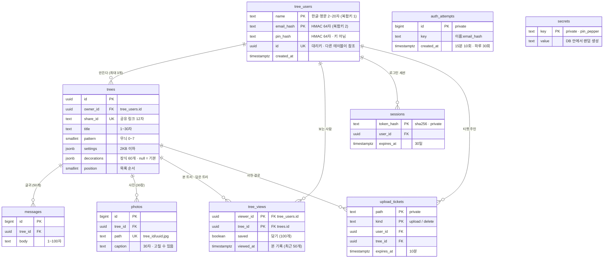
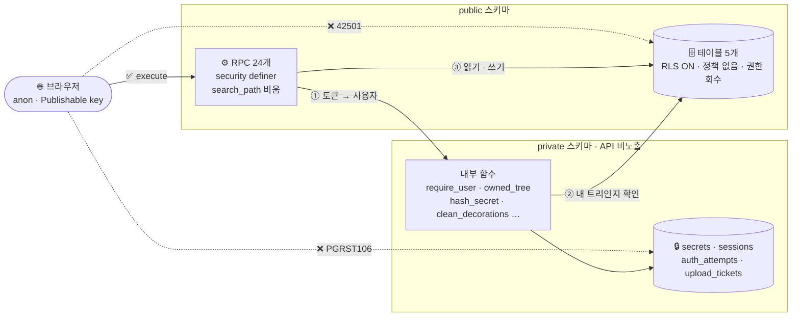
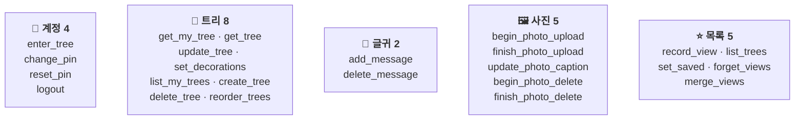

# DB 명세

| 마이그레이션 | 내용 |
|---|---|
| `20261117000000_init.sql` | 첫 배포 (v1: 이름+PIN, 사용자 1명 = 트리 1개). **이미 배포됨 — 수정 금지** |
| `20261117110000_accounts_v2.sql` | 계정 v2: (이름, 이메일) 복합 기본키 + PIN, 이메일 PIN 복구, 트리 분리(사용자당 3개), 무늬 8종. v1 데이터는 버림 |
| `20261117120000_tree_views.sql` | 본 트리 기록 · 담은 트리 |
| `20261118000000_decorations.sql` | 트리 장식 위치(`trees.decorations`) · 사진 캡션 고치기 |
| `20261118120000_names_en.sql` | 이름에 영문 허용(한글·영문 2~20자, 공백 한 칸) · 대소문자 무시(`lower(name)` 유일 인덱스) |

테스트: `supabase/tests/10_rpc_test.sql`(기본·보안), `20_views_test.sql`(목록), `30_multi_trees_test.sql`(트리 여러 개), `40_pin_reset_test.sql`(PIN 복구), `50_decorations_test.sql`(장식·캡션),
`upgrade/`(배포된 v1 DB에 적용하는 상황) — `./scripts/test-db.sh`가 모두 실행합니다.

> 그림은 GitHub에서 바로 보이는 [Mermaid](https://mermaid.js.org/) 다이어그램입니다.

## 한눈에 보기 — 테이블 관계



- 모든 외래키는 `on delete cascade`입니다. 사용자를 지우면 트리 → 글귀·사진 기록·본 기록·티켓까지 함께 지워집니다.
- `sessions` · `upload_tickets` · `auth_attempts` · `secrets`는 **private 스키마**라서 API로는 아예 보이지 않습니다.

## 한눈에 보기 — 누가 무엇에 접근하나



## 사용자 식별 — (이름, 이메일) + PIN

```
email_hash = HMAC-SHA256(pepper, 'email:' || 소문자 이메일)
pin_hash   = HMAC-SHA256(pepper, 'pin:' || 사용자 id || ':' || PIN)
기본키     = (name, email_hash)        ← PIN은 기본키가 아님 (틀리면 wrong_pin, 새 사용자를 만들지 않음)
```
- 동명이인은 이메일로 구분합니다. 가족이 메일 하나를 같이 써도 이름이 다르면 다른 사용자입니다.
- 이메일·PIN 모두 평문으로 저장하지 않습니다. pepper는 `private.secrets`에 있고 DB 밖으로 나가지 않습니다.
- 이름: 완성형 한글·영문 2~20자(단어 사이 공백 한 칸), NFC 정규화 + 공백 정리, 대소문자 무시(찾기 · 시도 제한 키는 `lower(name)`, 저장 · 표시는 처음 만든 그대로) · 이메일: 공백 제거+소문자, `아무개@도메인.최상위`, 254자 이하 · PIN: 숫자 4~10자리
- PIN 복구는 Supabase Auth 이메일 OTP로 메일 주인을 확인한 JWT가 있어야 합니다(`reset_pin`, `private.verified_email`).

## 테이블

### public.tree_users — 사용자
| 컬럼 | 타입 | 제약 |
|---|---|---|
| **name** | text | **PK①**, 2~20자 `^[가-힣A-Za-z]+( [가-힣A-Za-z]+)*$` (`tree_users_name_valid`), `(lower(name), email_hash)` 유일(`tree_users_name_ci_key`) |
| **email_hash** | text | **PK②**, HMAC hex 64자 |
| pin_hash | text | HMAC hex 64자 (사용자 id를 섞어 같은 PIN도 사람마다 다름) |
| id | uuid | unique, 다른 테이블이 참조하는 대리키 |
| created_at | timestamptz | |

### public.trees — 트리 (사용자당 최대 3개)
| 컬럼 | 타입 | 제약 |
|---|---|---|
| id | uuid | PK |
| owner_id | uuid | → tree_users.id (cascade) |
| share_id | text | unique, 공유 링크용 랜덤 12자 |
| title | text | 1~30자, 기본 'Merry Christmas' — 목록에 보이는 트리 **이름**도 이 값 |
| pattern | smallint | 0~7 (`web/js/tree/patterns.js`의 `PATTERNS` 순서) |
| settings | jsonb | object, 2KB 이하 — `{autoRotate, patternCycle, characters, gifts}` |
| decorations | jsonb | null(기본 장식) 또는 배열 60개 이하·8KB 이하 — `[{k, t, a, c}]` (아래 "장식 형식") |
| position | smallint | 내 트리 목록 순서 (0부터) |
| created_at / updated_at | timestamptz | updated_at은 트리거로 자동 갱신 |

### public.messages — 글귀 (트리당 50개)
`id` bigint PK · `tree_id` → trees.id (cascade) · `body` 1~100자 · `created_at`

### public.photos — 사진 메타데이터 (트리당 30장)
`id` bigint PK · `tree_id` → trees.id (cascade) · `path` unique `<tree_id>/<uuid>.jpg` · `caption` ≤30자 · `created_at`

### public.tree_views — 본 트리 기록 · 담은 트리
| 컬럼 | 타입 | 제약 |
|---|---|---|
| **viewer_id** | uuid | **PK①**, → tree_users.id (cascade) — 보는 사람 |
| **tree_id** | uuid | **PK②**, → trees.id (cascade) — 본 트리 |
| saved / saved_at | boolean / timestamptz | [담기] 여부와 시각 (보는 사람당 100개) |
| viewed_at | timestamptz | 마지막으로 본 시각, null이면 기록에서 지운 것 (보는 사람당 최근 50개) |

- `saved`이거나 `viewed_at`이 있어야 행이 존재합니다(체크 제약). 내 트리는 기록·담기 대상이 아닙니다.
- 읽기 전용 목록입니다. 담았다고 쓰기 권한이 생기지 않으며, 트리 주인 쪽에서 "누가 봤는지" 조회하는 RPC는 없습니다.

### private.* (API 비노출)
| 테이블 | 용도 |
|---|---|
| secrets | `pin_pepper` (init에서 랜덤 생성, 이름은 v1 그대로지만 v2 해시에도 쓰임) |
| sessions | `token_hash`(sha256) → user_id, 30일 만료 |
| auth_attempts | `key` = 이름:email_hash 단위 로그인·생성·PIN 변경 시도 기록 (맞히면 지움, 하루 지나면 정리) |
| upload_tickets | (path, kind=upload/delete) → user_id, tree_id, 10분 만료 |

모든 public 테이블은 **RLS ON + 정책 없음 + anon/authenticated 권한 회수** 상태입니다. 접근은 아래 RPC로만 합니다.

## RPC 함수 (브라우저가 호출) — 24개



모두 `security definer`, `set search_path = ''`이고, anon/authenticated에게만 실행 권한이 있습니다.
`p_tree_id`가 있는 함수는 생략하면 **순서상 맨 앞 트리**를 씁니다.

| 함수 | 인자 | 반환 | 오류 코드 |
|---|---|---|---|
| `enter_tree` | p_name, p_email, p_pin, p_create=false | `{ok, token, name, share_id(맨 앞 트리), created}` 또는 `{ok:false, error}` | invalid_name, invalid_email, invalid_pin, rate_limited, (반환) not_found / wrong_pin / rate_limited |
| `change_pin` | p_token, p_old_pin, p_new_pin | `{ok}` 또는 `{ok:false, error}` (다른 기기 로그아웃) | unauthorized, invalid_pin, rate_limited, (반환) wrong_pin |
| `reset_pin` | p_name, p_new_pin — **이메일 OTP로 로그인한 Supabase Auth JWT 필요** | `{ok, token, name, share_id, created:false}` (모든 기기 로그아웃, 시도 제한 초기화) | invalid_name, invalid_pin, email_unverified, not_found |
| `logout` | p_token | boolean | — |
| `get_my_tree` | p_token, p_tree_id? | Tree | unauthorized, not_found |
| `get_tree` | p_share_id | Tree | not_found |
| `update_tree` | p_token, p_title?, p_pattern?, p_settings?, p_tree_id? | Tree | unauthorized, not_found, invalid_title, invalid_pattern, invalid_settings |
| `set_decorations` | p_token, p_items jsonb(null이면 기본 장식으로), p_tree_id? | `{decorations}` (DB가 정리한 목록) | unauthorized, not_found, invalid_decorations |
| `list_my_trees` | p_token | `[{id, share_id, title, pattern, position, messages, photos}]` 순서대로 | unauthorized |
| `create_tree` | p_token, p_title? | Tree | unauthorized, tree_limit, invalid_title |
| `delete_tree` | p_token, p_tree_id | boolean | unauthorized, not_found, last_tree, tree_has_photos |
| `reorder_trees` | p_token, p_tree_ids uuid[] (내 트리 전체) | boolean | unauthorized, invalid_order |
| `add_message` | p_token, p_body, p_tree_id? | `{id, body}` | unauthorized, not_found, invalid_message, limit_reached |
| `delete_message` | p_token, p_id | boolean (내 글이 아니면 false) | unauthorized |
| `begin_photo_upload` | p_token, p_tree_id? | path | unauthorized, not_found, limit_reached |
| `finish_photo_upload` | p_token, p_path, p_caption='' | `{id, path, caption}` | unauthorized, invalid_ticket, file_missing |
| `update_photo_caption` | p_token, p_photo_id, p_caption (빈 값 = 캡션 없음) | `{id, path, caption}` | unauthorized, not_found, invalid_caption |
| `begin_photo_delete` | p_token, p_photo_id | path | unauthorized, not_found |
| `finish_photo_delete` | p_token, p_photo_id | boolean | unauthorized, file_still_exists |
| `record_view` | p_token, p_share_id | `{own, saved}` (내 트리면 기록 안 함) | unauthorized, not_found |
| `list_trees` | p_token | `[{share_id, name, title, saved, saved_at, viewed_at}]` 최근 순 | unauthorized |
| `set_saved` | p_token, p_share_id, p_saved | boolean (담긴 상태) | unauthorized, not_found, own_tree, save_limit |
| `forget_views` | p_token, p_share_id=null(전부) | integer (지운 기록 수, 담은 트리는 남음) | unauthorized |
| `merge_views` | p_token, p_items `[{share_id, viewed_at}]` | integer (합친 수, 앞 50개만, 없는 링크·내 트리 제외) | unauthorized, invalid_items |

**Tree 형식**
```json
{
  "id": "<uuid>", "name": "김민수", "title": "민수네 트리", "pattern": 2, "position": 0,
  "settings": { "autoRotate": true, "patternCycle": true, "characters": true, "gifts": true },
  "share_id": "aB3_xY9-kLm0",
  "decorations": [{ "k": "sock", "t": 0.62, "a": 0.25, "c": 0 }],
  "messages": [{ "id": 1, "body": "메리 크리스마스" }],
  "photos":   [{ "id": 3, "path": "<tree_id>/<uuid>.jpg", "caption": "첫 사진" }]
}
```

**장식 형식** (`decorations`의 항목, `private.clean_decorations`가 검사·정리)
| 키 | 값 | 뜻 |
|---|---|---|
| k | bulb · ball · star · sock · bell · candy · bow · flake | 종류 (전구·방울·별·양말·종·사탕·리본·눈꽃). 새 종류는 SQL과 `web/js/tree/decor.js`의 `ORNAMENTS`에 함께 추가 |
| t | 0.05 ~ 1 | 트리 원뿔 표면의 높이 (꼭대기 0 → 바닥 1) |
| a | 0 이상 1 미만 | 둘레 각도 (한 바퀴 = 1). 범위를 넘으면 DB가 0~1로 접음 |
| c | 0 ~ 5 정수 (생략하면 0) | 색 — `DECOR_COLORS` 순서 (빨강·금색·파랑·초록·분홍·하양) |

- 모르는 키는 버리고 숫자는 소수 4자리로 반올림해서 저장합니다. 위치가 트리 표면 좌표라서 장식이 트리와 함께 돕니다.
- `null`은 "아직 손대지 않은 트리"(화면이 기본 장식을 보여 줌), `[]`는 "장식을 모두 뗀 트리"입니다.

## 제한 값 (바꾸려면 마이그레이션 + 테스트 + 이 표를 함께 수정)
| 항목 | 값 | 위치 |
|---|---|---|
| 이름 | 한글·영문 2~20자, 공백 한 칸, 대소문자 무시 | private.valid_name · normalize_name, tree_users 제약 · lower 인덱스, api.js `isValidName` · `normalizeName` |
| 이메일 | 254자 이하, `아무개@도메인.최상위` | private.valid_email, api.js `isValidEmail` |
| PIN | 숫자 4~10자리 | private.valid_pin, api.js `isValidPin` |
| 로그인 시도 | (이름, 이메일)당 15분 10회 + 하루 30회 | private.assert_rate |
| PIN 복구 | 메일 확인 후 15분 안에 | private.verified_email (amr timestamp) |
| 신규 사용자 | 전체 1시간 60명 | enter_tree |
| 세션 | 30일 | enter_tree |
| 트리 | 사용자당 3개 | create_tree |
| 무늬 | 0~7 | trees_pattern 제약, update_tree, patterns.js |
| 글귀 | 100자, 트리당 50개 | add_message |
| 사진 | 트리당 30장, 2MB, JPEG | begin_photo_upload, 버킷 설정 |
| 사진 캡션 | 30자 | photos 제약, finish_photo_upload(잘라냄), update_photo_caption(거부) |
| 장식 | 트리당 60개, 8KB | trees_decorations 제약, private.clean_decorations, decor.js `MAX_DECOR` |
| 업로드/삭제 티켓 | 10분 | begin_photo_* |
| 본 기록 | 보는 사람당 최근 50개 | private.trim_views, merge_views(입력 50개) |
| 담은 트리 | 보는 사람당 100개 | set_saved |

## 새 RPC를 추가할 때 체크리스트
1. `create or replace function public.xxx(...) ... security definer set search_path = ''`
2. 함수 안의 모든 이름은 스키마까지 붙여 쓰기 (`public.photos`, `extensions.digest`)
3. 로그인이 필요하면 맨 앞에서 `private.require_user(p_token)`을 호출. 트리를 다루면 `private.owned_tree(user, p_tree_id)`로 소유 확인
4. 오류는 짧은 영어 코드로 raise → `web/js/api.js`의 `ERROR_MESSAGES`(한국어)와 `ERROR_MESSAGES_EN`(영어)에 메시지 추가
5. 실패 기록을 남겨야 하는 경로는 raise 대신 `{ok:false, error}`를 return (롤백 방지)
6. 마이그레이션 끝의 grant 목록에 시그니처 추가 (새 private 함수는 revoke)
7. `supabase/tests/`에 정상 경로와 권한 침해 경로 테스트를 추가하고 `./scripts/test-db.sh` 통과 확인
   - 같은 SQL 문장 안에서 쓰기 RPC와 `stable` 조회 함수를 함께 부르면 조회가 쓰기 전 스냅샷을 봅니다. 문장을 나누세요.
8. `tests/e2e/mock-supabase.js`(E2E용 mock)도 같은 규칙으로 맞추기 (Supabase Auth를 쓰면 mock의 `auth`도)
9. 이 문서의 표 갱신
